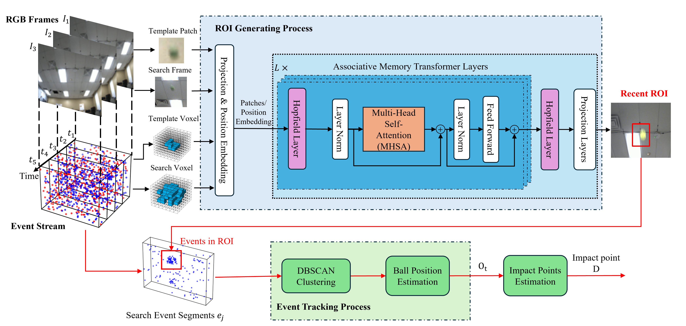

# Event_RGB_catching

Real-time ball detection, tracking, and landing prediction/catching using event cameras and RGB cameras. The system is built as a multi-process pipeline with shared memory, covering event/RGB data ingestion, ROI generation, 2D/3D tracking, trajectory fitting, and robot control, plus optional GUI visualization.

## Key Features
- Event-only and RGB-assisted tracking modes
- ROI generation (model-based and color-threshold based)
- 3D trajectory reconstruction and landing prediction
- Motor/robot control interface
- Multi-process shared-memory data flow with GUI display

## Entry Scripts
Common entry points (by usage):
- `live_real.py`: full pipeline (event + RGB/model ROI + tracking + prediction + control + GUI)
- `live.py`: event-camera live mode (simplified)
- `record.py`: aligned-buffer recording and tracking pipeline
- `run_record.py`: auto-restart batch runner for `record.py`
- `show_data.py`: playback/visualization for aligned data + GUI

Examples:
```bash
# Live event-only mode
python live.py --task normal

# Full pipeline (adjust test_mode and task as needed)
python live_real.py --test_mode Event --task normal

# Recording / processing pipeline
python record.py --record_index 0 --test_mode Event --task normal

# Batch runs for record.py
python run_record.py --start_index 0 --test_mode Event --task normal

# Playback / visualization
python show_data.py --record_index 0 --test_mode Show --task normal
```

Note: `--task` options differ slightly per script. Check each script's `argparse` `choices` for exact values.

## Media

### Perception Model Overview Diagram



### Demo Video (GIF/MP4)


## Configuration
- `config/`: YAML configs used by different modes.
- Config selection is based on `--test_mode` and `--task`.
- Environment variables supported:
  - `ACTIVE_CONFIG_FILE`: explicit config file path (highest priority)
  - `ACTIVE_TASK`: task name (e.g., normal/dark/clutter)
  - `TEST_MODE`: mode (Event/RGB/Model)
  - `ENABLE_GUI=0`: disable GUI

See `config/config_loader.py` for the selection logic.

## Project Structure (Core Modules)
- `data_input/`: event/video/RGB/aligned-buffer readers
- `ROI_generation/`: ROI generation (model/color)
- `tracking_2D/`: event/RGB tracking
- `fitting/`: trajectory fitting and landing prediction
- `hardware/`: motor control interface
- `gui_process.py`: GUI display process
- `AMTTrack/`: tracking model and related tooling

## Dependencies
This is a Python project. Common dependencies include:
- `numpy`, `opencv-python`, `torch`, `pyyaml`, `pynput`

For real hardware (event camera / FLIR / motor), you will also need the corresponding SDKs and drivers.

For the verified Ubuntu 22.04/Python 3.10 version matrix, strict installation
order, camera SDK setup, and validation commands, see
[UBUNTU22_INSTALL.md](UBUNTU22_INSTALL.md).

## Interaction Notes
Some scripts use keyboard control (via `pynput`). Typical keys:
- `t`: start tracking
- `w`: wait/pause
- `e`: exit (in some scripts)

Refer to console logs for exact behavior.

---
